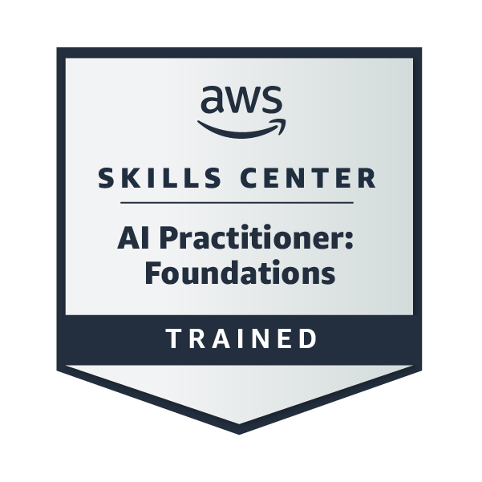

  

&nbsp;&nbsp;&nbsp;
&nbsp;&nbsp;&nbsp;
&nbsp;&nbsp;&nbsp;
&nbsp;&nbsp;&nbsp;

<b>Portfolio</b> &nbsp;·&nbsp; <b>LinkedIn</b> &nbsp;·&nbsp; <b>GitHub</b> &nbsp;·&nbsp; <b>Email</b> &nbsp;·&nbsp; <b>AWS badge</b>

 

## Snapshot

| | |
|---|---|
| **Role** | Software Engineer (backend, databases, applied AI) |
| **Education** | BSc Honours, Computer Science & Informatics, University of the Free State (completing Nov 2026) · Top 15%, Golden Key |
| **Strengths** | Database-level integrity and security, full-stack delivery, concurrency, NLP on financial text |
| **Core stack** | C# · .NET · React · TypeScript · Python · PostgreSQL · SQL Server · Supabase |
| **Experience** | Full-Stack Developer Intern (.NET microservices, PostgreSQL) · programming tutor · lab assistant |
| **Availability** | 2027 · open to graduate and junior roles, onsite, relocation or remote |

---

## Why engineering teams hire me

**I put the rules where they can't be bypassed.** In my Honours system I enforce business rules as PostgreSQL constraints, triggers and stored functions, and secure every table with row-level security, so correctness doesn't depend on the client.

**I debug concurrency, not just features.** I stopped double-booking of the last seat with row-level locking (`SELECT ... FOR UPDATE`).

**I ship under pressure.** First place at BBD Best Repo as lead developer of a full-stack application, a top-3 finish at a 24-hour hackathon where I led the team, and a 48-hour banking hackathon where I designed the data model for a fraud-monitoring demo.

**I explain things clearly.** I tutor first-year programmers and support students and staff as a lab assistant, so I can work with both technical and non-technical people.

---

## Selected work

<b>ITSL Session Management System</b> · Honours capstone · Lead Developer

 

Replaced a spreadsheet-and-email process for **100+ students** over a ten-week module with a role-based platform for students, facilitators and a coordinator.

- Academic rules enforced in **PostgreSQL** (constraints, triggers, stored functions)
- **Row-level security** on every table, keyed on the authenticated user
- **Row-level locking** to prevent two students taking the last seat
- Automated certificate PDFs and email delivery with serverless **Deno Edge Functions**
- Limits derived from live data, so the system re-sizes when the intake changes

`React` `Supabase` `PostgreSQL` `Deno`

<b>BBD Best Repo</b> 🥇 · First place · Lead Developer

 

Lead developer responsible for the full-stack application that won first place for best repository.

`[add stack]`

<b>BridgeUni</b> 🏆 · Top 3 team, BizTech Nexus Hackathon (24h) · Team Lead

 

One platform where students find bootcamp and upskilling resources from around the world. I led the team and designed and built the full-stack application.

`MongoDB` `Express` `React` `Node.js`

<b>CodeRED</b> · Standard Bank Beat the Banker Hackathon (48h)

 

Digital banking and fraud-monitoring demo with a mule-account detection pipeline (heuristic scoring or a model exported from a notebook). I designed the data model used to track scammers and was recognised for my data science contribution.

`FastAPI` `Streamlit` `SQLite` `Python`

<b>Financial Sentiment Analysis (FinBERT)</b> · Project Lead

 

Fine-tuned FinBERT on **4,840 labelled financial headlines**. Handled label noise and class imbalance with a Regex cleaning pipeline and evaluated with **macro-F1** so minority classes weren't hidden.

`Python` `PyTorch` `Transformers` `NLTK`

<b>UFS Student Recruitment Platform</b> · Lead Developer

 

Matches student skills to employer requirements through automated recommendations.

`C#` `.NET` `SQL Server` `React`

---

## Tech stack

---

## Credentials

<table>
<tr>
<td align="center" width="25%"> <b>AWS AI Practitioner: Foundations</b> Training badge · verify on Credly</td>
<td align="center" width="25%"> <b>Seeds for the Future</b> Alumna, 2023–2024</td>
<td align="center" width="25%"> <b>Cisco Networking Academy</b> 2024</td>
<td align="center" width="25%"> <b>Data Analytics: Foundations</b> LinkedIn Learning, 2026</td>
</tr>
</table>

**Also:** Golden Key International Honours Society (top 15%) · Leadership 2050 Summit 2.0 participant (2024)

---

## GitHub activity

---

### Let's build something reliable.

**Open to graduate and junior software engineering roles · onsite, relocation or remote**

